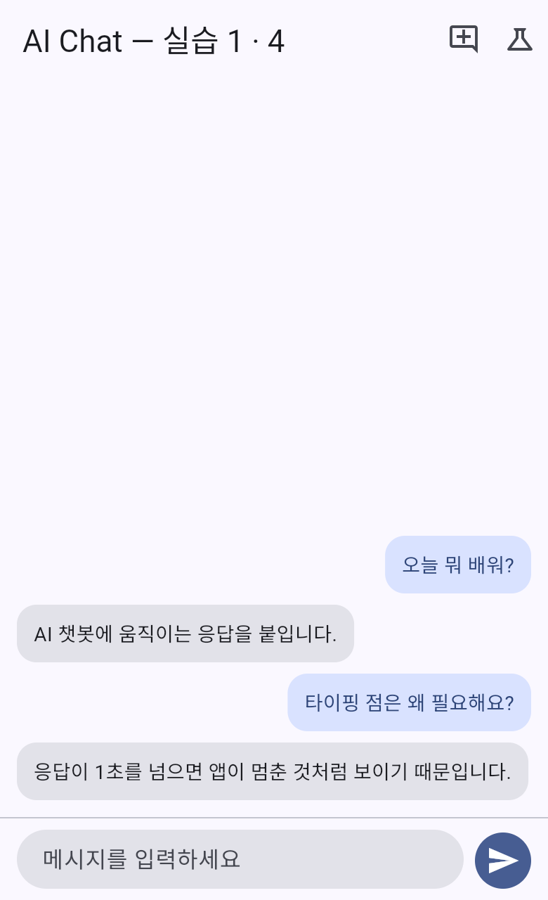
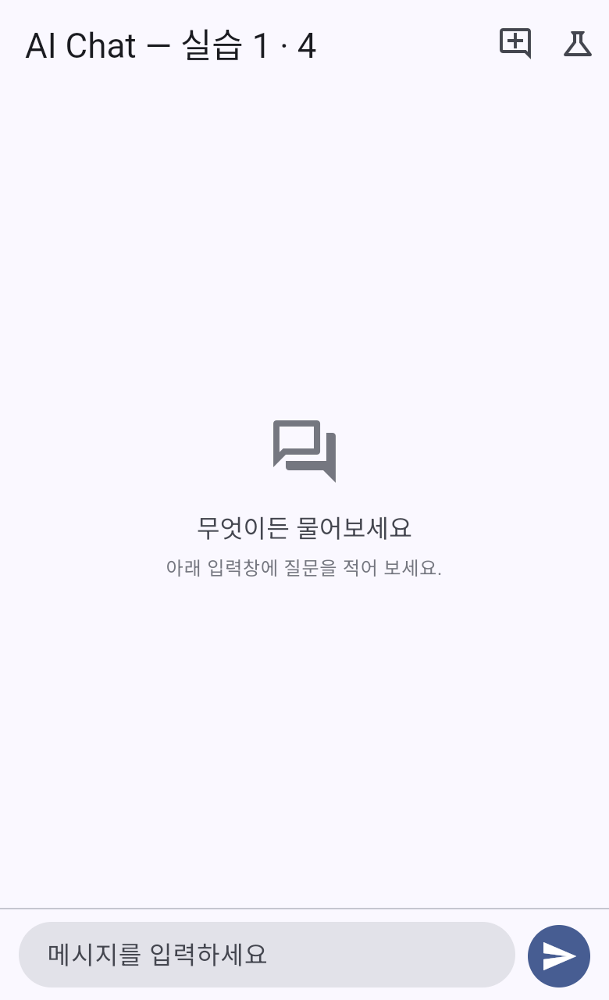
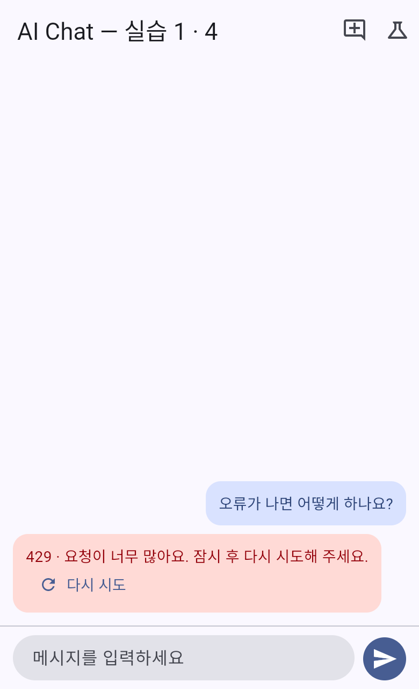
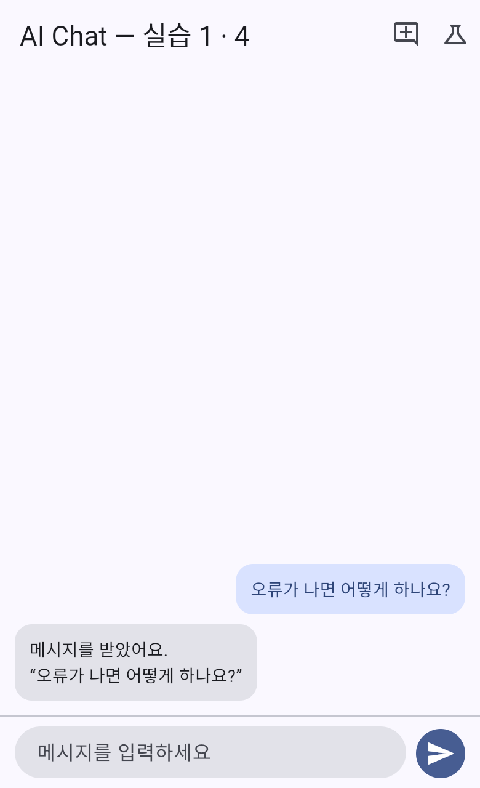

# 실습 1 · 4 — 채팅 UI와 오류 처리 (GAI3008-01 · 11주차)

## 실행

```bash
flutter pub get
flutter run -d chrome
flutter test
```

별도 서버나 API 키 없이 실행할 수 있다. 정상 응답과 오류는 앱에서 시뮬레이션한다.

## 실행 화면

| 채팅 UI | 빈 대화 |
| --- | --- |
|  |  |

| 429 오류와 재시도 버튼 | 같은 메시지 재시도 후 |
| --- | --- |
|  |  |

## 실습 1 · 채팅 UI

- `ListView.builder(reverse: true)`로 최신 메시지를 아래에 배치한다.
- 사용자 말풍선은 오른쪽, AI 말풍선은 왼쪽에 표시한다.
- 하단 입력창에서 전송 버튼이나 키보드의 전송 키로 메시지를 보낸다.
- 상단의 **새 대화** 버튼을 누르면 대화가 비워지고 “무엇이든 물어보세요”가 표시된다.
- 키보드가 올라오면 본문이 줄어들어 입력창이 키보드 위에 남는다.

## 실습 4 · 오류와 재시도

1. 상단의 **응답 시나리오** 메뉴에서 401, 429, 500 또는 Timeout을 선택하고 메시지를 보낸다.
2. 실패하면 공통 오류 말풍선에 원인이 표시된다. **다시 시도**를 누르면 마지막 실패 메시지로 복구를 시뮬레이션하며 사용자 말풍선이 중복되지 않는다.
3. 429인 경우 첫 자동 재시도 전 1초, 두 번째 자동 재시도 전 2초를 기다린다. **429 오류**는 두 번을 모두 시도한 후 오류가 표시되고, **429 후 정상 응답**은 두 번째 재시도에서 응답을 받는다.
4. `AnimatedSwitcher`가 대기, 오류, 응답을 전환한다. 실패 후에도 입력과 전송이 가능하며, 새 메시지를 보내도 이전 오류는 대화에 남는다.

---

ⓒ 2026 Baryon Labs · 연세대학교 GAI3008-01 응용모바일프로그래밍 교육자료
